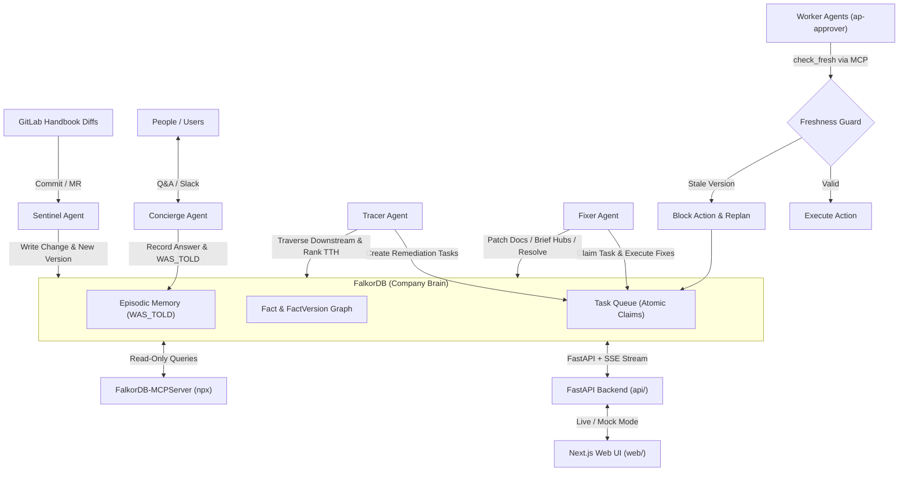
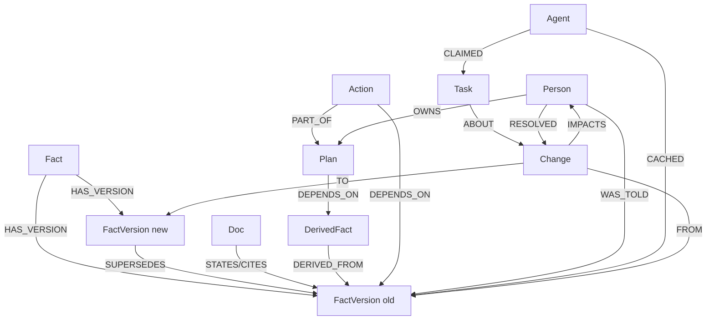

# Ripple

> **The company brain that remembers what it told you, and comes back to fix it when the truth changes.** Built on FalkorDB.

Ripple records every fact version it hands out—to people, documents, and other agents. When a fact changes, it walks the knowledge graph to find everyone and everything still relying on the old version, ranks them by **time-to-harm**, blocks stale actions before execution, re-answers people with self-correcting memory, drafts documentation updates, and replans dependent work until resolution coverage reaches 100%.

Built for **Graph Hacks: Context for AI Agents** (WeMakeDevs × FalkorDB, Oct 15–18, 2026).  
**Track Submissions:**
- **Track 01:** Agents That Act on Connected Data *(FalkorDB as the primary source of truth, MCP freshness guard)*
- **Track 02:** Agent Memory & Coordination *(Episodic memory via `WAS_TOLD`, atomic `Task` node handoffs)*
- **Track 03:** Company Brain *(Autonomous policy diff ingestion, multi-hop impact graph, time-to-harm prioritization)*

---

## Quick Links
- **Live Demo:** [https://ripple-brain.vercel.app](https://ripple-brain.vercel.app) *(or `npm run dev` locally in mock/live mode)*
- **Demo Video:** [https://youtu.be/ripple-falkordb-demo](https://youtu.be/ripple-falkordb-demo) *(2:45 walkthrough, details in [`docs/video/FINAL_DEMO.md`](docs/video/FINAL_DEMO.md))*
- **Project Board:** [Ripple – Graph Hacks](https://github.com/users/sahil1330/projects/5/views/1)
- **Deployment Guide:** [`docs/DEPLOYMENT.md`](docs/DEPLOYMENT.md) & [`deploy/README.md`](deploy/README.md)
- **MCP Integration:** [`docs/MCP.md`](docs/MCP.md)

---

## Architecture

Ripple connects autonomous agents, ingestion pipelines, and interactive user interfaces through **FalkorDB**:



- **Atomic Coordination in the Graph:** Agents coordinate entirely through `Task` nodes in FalkorDB (`CREATE Task{status:'open'}`, atomic conditional claim `MATCH ... {status:'open'} SET status='claimed'`, write `RESOLVED`). No fragile inter-agent point-to-point RPCs.
- **Freshness Guard (`check_fresh`):** Autonomous workers must verify that their input facts are current before executing real-world actions. Stale facts immediately abort the action and create a replan task.
- **Deterministic Demo:** Fully reproducible scenario using real GitLab policy changes and seeded synthetic holders.

<!-- A:start (owned by @sahil1330: data model, Cypher & algorithms, what breaks without FalkorDB) -->
## Graph data model
One FalkorDB graph per tenant (`ripple:<tenant>`). Every node has `:Entity`, `id`, `kind`, `synthetic`. Times are epoch-ms integers.



Full label and relationship tables: [`contracts/graph-model.md`](contracts/graph-model.md).

## Cypher & algorithms
_To be completed. Every query lives in [`graph/queries/`](graph/queries)._

| Query / algorithm | Purpose |
|---|---|
| impact radius (variable-length traversal, `algo.bfs`, `algo.SSpaths`) | everything downstream of a superseded fact version |
| `who_holds` | people and agents still holding the old version |
| `check_fresh` | freshness guard before any agent action |
| `explain_path` (`shortestPath`, `algo.SPpaths`) | why is this entity affected |
| `coverage` | impacted vs resolved per kind |
| `algo.pageRank`, `algo.betweenness`, `algo.WCC` | doc authority, amplifiers, dark pockets |

## What breaks without FalkorDB
_To be completed._
<!-- A:end -->

## Setup & Local Run (< 10 minutes)

You can launch and explore Ripple locally in under 10 minutes with Docker, Python, and Node.js.

### 1. Prerequisites
- Docker & Docker Compose
- Python 3.12+
- Node.js 20+ and npm

### 2. Start FalkorDB
Start the FalkorDB instance:
```bash
docker compose up -d falkordb
```
FalkorDB is now accessible at `localhost:6379`.

### 3. Backend Setup & Seeding
In the project root, configure Python and install dependencies:
```bash
cp .env.example .env
python3 -m venv .venv
source .venv/bin/activate
pip install -r requirements.txt -r requirements-dev.txt

# Run test suite to verify graph and contract tests
pytest -q

# Seed the FalkorDB database with the C1 scenario
./deploy/seed.sh handbook-demo 42

# Start the FastAPI server (with SSE streaming)
uvicorn api.main:app --reload --port 8000
```
Verify the backend is live at [http://localhost:8000/api/health](http://localhost:8000/api/health).

### 4. Start the Web UI
In a separate terminal:
```bash
cd web
npm install
npm run dev
```
Open [http://localhost:3000](http://localhost:3000) in your browser.

### 5. Exploring Demo Mode
To walk through the full C1 scenario step-by-step:
- Navigate to [http://localhost:3000/?demo=1](http://localhost:3000/?demo=1).
- Use `Space` or the **Next ▶** button to advance through the 6 stages.
- Watch nodes pulse red by risk, see `ap-approver` get blocked, inspect the 'Why?' drawer with exact Cypher, and observe the coverage meter sweep to 100% green.
- Press `R` or click **Reset** at any time to re-run.

---

## Data Sources & Synthetic Disclosure

- **Real Policy Changes:** Real-world handbook updates extracted from the public [GitLab Handbook repository](https://gitlab.com/gitlab-com/content-sites/handbook) git history (commit `ddd39597`, MR !20421; © GitLab B.V.). Used under public open documentation terms; excerpts and links only.
- **Synthetic Layer:** To demonstrate organizational impact without using private corporate data, the surrounding company layer (people, teams, Slack conversations, action queues, worker agents) is **synthetic**. Every synthetic record is explicitly tagged with `synthetic: true` in FalkorDB and visually marked with a badge in the web UI.

---

## AI Assistance Disclosure

In full compliance with hackathon transparency guidelines:
Ripple was developed collaboratively using **Cursor** (the Cursor IDE editor, Cursor agent, and Cursor cloud agents) alongside Antigravity pair programming:
- **Scaffolding & Boilerplate:** Scaffolding FastAPI routes, Next.js components, Tailwind styles, and Docker/CI files.
- **Cypher & Algorithm Optimization:** Iterating and smoke-testing FalkorDB Cypher queries (`algo.bfs`, `shortestPath`, `algo.pageRank`, `algo.betweenness`, `algo.WCC`).
- **Tests & Contracts:** Generating OpenAPI 3.1 schemas, fixture contract tests, and GitHub Actions workflow gates.
- **Verification:** Both team members (`@sahil1330` and `@harsh-gupta-10`) actively reviewed, tested, and can explain every single query, architectural decision, and line of code in the repository.

---

## Team & Responsibilities

- **Sahil Mane** ([@sahil1330](https://github.com/sahil1330)): Core graph engine, Cypher queries, FalkorDB client, ingestion pipelines, autonomous agents (Sentinel, Tracer, Fixer, Worker), `ripple_mcp` server, FastAPI backend.
- **Harsh Gupta** ([@harsh-gupta-10](https://github.com/harsh-gupta-10)): Web presentation UI (Next.js, `react-force-graph-2d`, Tailwind), cloud deployment configurations, documentation, demo video production, and CI/CD automation.

---

## Credits & Acknowledgements

- [FalkorDB](https://www.falkordb.com/) for the lightning-fast graph database and GraphBLAS graph algorithms.
- [FalkorDB-MCPServer](https://github.com/FalkorDB/FalkorDB-MCPServer) for upstream Model Context Protocol graph exploration.
- [GitLab](https://gitlab.com) for their pioneering public handbook culture.
