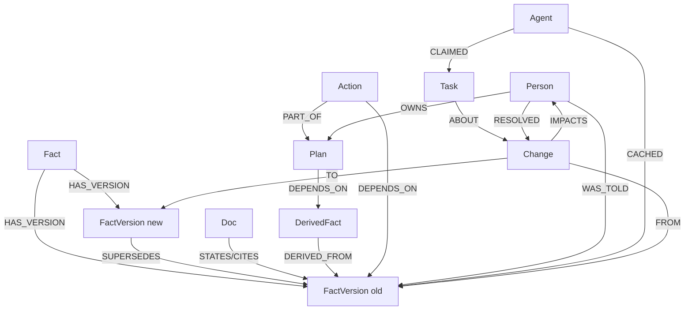

# Ripple

> **The company brain that remembers what it told you, and comes back to fix it when the truth changes.** Built on FalkorDB.

Ripple records every fact version it hands out, to people, documents and other agents. When a fact changes, it walks the graph to find everyone and everything still relying on the old version, ranks them by time-to-harm, blocks stale actions, re-answers people, drafts doc fixes and replans dependent work until coverage hits 100%.

Built for **Graph Hacks: Context for AI Agents** (WeMakeDevs × FalkorDB, Oct 15–18 2026). Tracks: 01 Agents That Act on Connected Data · 02 Agent Memory & Coordination · 03 Company Brain.

- Live demo: _coming soon_
- Demo video: _coming soon_
- Board: [Ripple – Graph Hacks](https://github.com/users/sahil1330/projects/5)

## Architecture
_Diagram coming soon (see `RIPPLE_PLAN.md` §5)._ Sentinel, Tracer, Fixer, Concierge and worker agents share state through `Task` nodes in FalkorDB; a FastAPI + SSE backend feeds a Next.js UI; `ripple-mcp` exposes the graph to agents over MCP.

<!-- A:start (owned by @sahil1330: data model, Cypher & algorithms, what breaks without FalkorDB) -->
## Graph data model
One FalkorDB graph per tenant (`ripple:<tenant>`). Every node has `:Entity`, `id`, `kind`, `synthetic`. Times are epoch-ms integers.



Full label and relationship tables: [`contracts/graph-model.md`](contracts/graph-model.md).

## Cypher & algorithms
_To be completed. Every query lives in [`graph/queries/`](graph/queries)._

| Query / algorithm | Purpose |
|---|---|
| impact radius (variable-length traversal, `algo.bfs`, `algo.SSpaths`) | everything downstream of a superseded fact version |
| `who_holds` | people and agents still holding the old version |
| `check_fresh` | freshness guard before any agent action |
| `explain_path` (`shortestPath`, `algo.SPpaths`) | why is this entity affected |
| `coverage` | impacted vs resolved per kind |
| `algo.pageRank`, `algo.betweenness`, `algo.WCC` | doc authority, amplifiers, dark pockets |

## What breaks without FalkorDB
_To be completed._
<!-- A:end -->

## Setup
_Placeholder, finalised on Day 4._

```bash
cp .env.example .env
docker compose up -d falkordb                      # FalkorDB :6379, browser :3000
python -m venv .venv && . .venv/bin/activate
pip install -r requirements.txt -r requirements-dev.txt
pytest -q
uvicorn api.main:app --reload                      # http://localhost:8000/api/health
cd web && cp .env.example .env.local && npm install && npm run dev   # http://localhost:3000
```

## Data sources & licence
- Real policy changes from the public [GitLab handbook](https://gitlab.com/gitlab-com/content-sites/handbook) git history (© GitLab B.V.). Short excerpts and links only.
- Everything else (people, teams, chats, plans, worker agents) is **synthetic**, marked `synthetic: true` and badged in the UI.

## AI assistance
We used **Cursor** (the Cursor editor and its agent, plus Cursor cloud agents) for project scaffolding, code, tests and PR review. Both team members reviewed and can explain all merged code. Each PR records its own disclosure.

## Team
- Sahil Mane ([@sahil1330](https://github.com/sahil1330)): graph, data, agents, MCP, API
- Harsh ([@harsh-gupta-10](https://github.com/harsh-gupta-10)): web, deploy, docs, demo

See [`CONTRIBUTING.md`](CONTRIBUTING.md) for how we work.

## Credits
[FalkorDB](https://www.falkordb.com/) and its Python client, [FalkorDB-MCPServer](https://github.com/FalkorDB/FalkorDB-MCPServer), Next.js, react-force-graph. Related work: Graphiti, Lethe.
