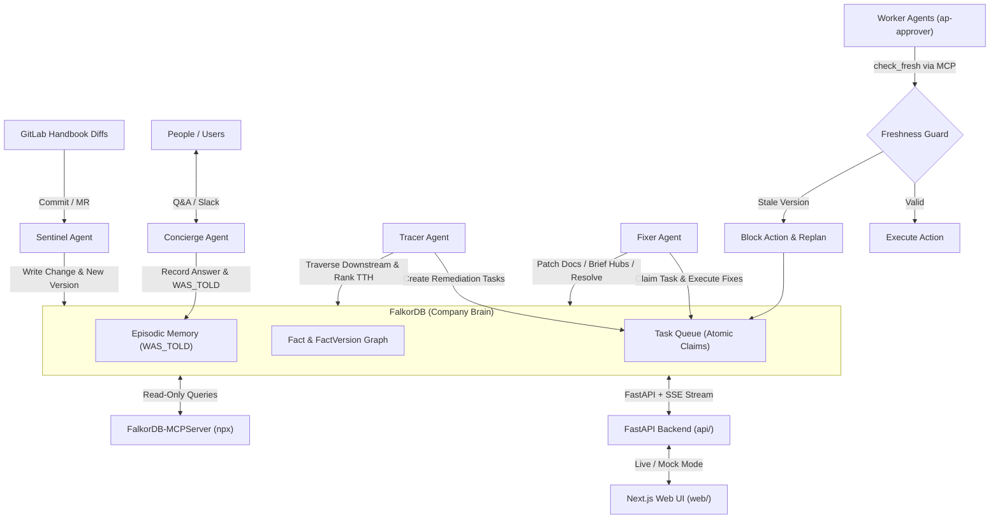
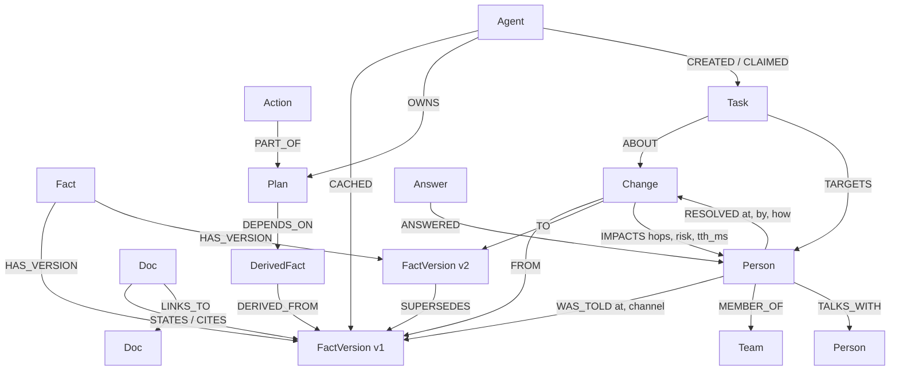

# Ripple

> **The company brain that remembers what it told you, and comes back to fix it when the truth changes.** Built on FalkorDB.

Ripple records every fact version it hands out—to people, documents, and other agents. When a fact changes, it walks the knowledge graph to find everyone and everything still relying on the old version, ranks them by **time-to-harm**, blocks stale actions before execution, re-answers people with self-correcting memory, drafts documentation updates, and replans dependent work until resolution coverage reaches 100%.

Built for **Graph Hacks: Context for AI Agents** (WeMakeDevs × FalkorDB, Oct 15–18, 2026).  
**Track Submissions:**
- **Track 01:** Agents That Act on Connected Data *(FalkorDB as the primary source of truth, MCP freshness guard)*
- **Track 02:** Agent Memory & Coordination *(Episodic memory via `WAS_TOLD`, atomic `Task` node handoffs)*
- **Track 03:** Company Brain *(Autonomous policy diff ingestion, multi-hop impact graph, time-to-harm prioritization)*

---

## Quick Links
- **Live Demo:** [https://ripple-2.up.railway.app](https://ripple-2.up.railway.app) *(or `npm run dev` locally in mock/live mode)*
- **Live API:** [https://ripple-production-be6b.up.railway.app/api/health](https://ripple-production-be6b.up.railway.app/api/health)
- **Demo Video:** **TODO: add the YouTube link once the demo video is recorded** (script: [`docs/video/FINAL_DEMO.md`](docs/video/FINAL_DEMO.md))
- **Project Board:** [Ripple – Graph Hacks](https://github.com/users/sahil1330/projects/5/views/1)
- **Deployment Guide:** [`docs/DEPLOYMENT.md`](docs/DEPLOYMENT.md) & [`deploy/README.md`](deploy/README.md)
- **MCP Integration:** [`docs/MCP.md`](docs/MCP.md)

---

## Architecture

Ripple connects autonomous agents, ingestion pipelines, and interactive user interfaces through **FalkorDB**:



- **Atomic Coordination in the Graph:** Agents coordinate entirely through `Task` nodes in FalkorDB (`CREATE Task{status:'open'}`, atomic conditional claim `MATCH ... {status:'open'} SET status='claimed'`, write `RESOLVED`). No fragile inter-agent point-to-point RPCs.
- **Freshness Guard (`check_fresh`):** Autonomous workers must verify that their input facts are current before executing real-world actions. Stale facts immediately abort the action and create a replan task.
- **Deterministic Demo:** Fully reproducible scenario using real GitLab policy changes and seeded synthetic holders.

<!-- A:start (owned by @sahil1330: data model, Cypher & algorithms, what breaks without FalkorDB) -->
## Graph data model
One FalkorDB graph per tenant (`ripple:handbook-demo`, `ripple:acme-synthetic`). Every node carries `:Entity` plus one main label, and the properties `id` (prefixed by kind, e.g. `fv:vpn:v1`), `kind` and `synthetic`. All times are epoch-ms integers, and `valid_to = null` marks the current version of a fact.

Dependency edges point **dependent → dependency** (Priya `WAS_TOLD` v1). Ingest mirrors every one of them with a `FEEDS {w:1}` edge in the opposite direction, so the graph algorithms (which follow outgoing edges only) can walk "what does this version feed?" over a single relationship type.



Full label, property and relationship tables: [`contracts/graph-model.md`](contracts/graph-model.md). Indexes (`graph/schema.py`): `Entity(id)`, `Fact(key)`, `FactVersion(valid_to)`, `Task(status)`, `Action(status)`, `WAS_TOLD(at)`, and full-text on `Doc(title)`.

**Data.** The fact versions are real: five changes (C1–C5) to `content/handbook/finance/expenses.md` in GitLab's public handbook, with excerpts and permanent commit links (`ingest/data/handbook_changes.json`). The docs are 74 real handbook finance pages and their 42 hyperlinks. Everyone and everything holding a version is synthetic and seeded (`ingest/synthetic.py`: 24 people, 40 Concierge answers, 8 agents, 6 wiki docs, 4 plans and 5 actions), with a different seed for each tenant.

## Cypher & algorithms
Every query the product runs is a parameterised `.cypher` file in [`graph/queries/`](graph/queries), loaded by name with `graph.cypher.cypher("<name>")`. The core ones, in demo order (C1: personal VPN, commit `ddd39597`, MR !20421):

| Query / algorithm | Used by | Purpose |
|---|---|---|
| `ingest_fact_version`, `ingest_change` | ingest, Sentinel | upsert Fact + FactVersion; record a Change (`SUPERSEDES`, close old `valid_to`, `FROM`/`TO`) |
| `impact_bfs`: `algo.bfs(old, 6, 'FEEDS')` + `min(length(p))` | Tracer, `/api/changes/{id}/impact` | everything downstream of the superseded version, with hop distance (C1: 24 entities) |
| `algo_betweenness_feeds`: `algo.betweenness` on `FEEDS` | TTH ranking, `rank_amplifiers` | "reach": entities that relay the stale fact to many others |
| `algo_pagerank_docs`: `algo.pageRank('Doc','LINKS_TO')` | TTH ranking, `rank_amplifiers` | doc authority over the real handbook link graph |
| `tth_due` | TTH ranking | soonest deadline per entity (own `due_at`/`act_by`, or inherited through `OWNS`) |
| `write_impacts` | Tracer | materialise `(:Change)-[:IMPACTS {hops, risk, tth_ms, severity, urgency, reach}]->(x)` |
| `task_create`, `task_claim`, `task_complete` | all agents | Task handoff. The claim is one query that picks the best open task and flips it to `claimed` (writes are serialised per graph, so two agents never get the same task) |
| `check_fresh`: `PART_OF*0..1`, `DERIVED_FROM*0..5`, `SUPERSEDES*1..10` | worker agents over MCP | freshness guard: any row means the plan/action depends on a closed version, so it is BLOCKED with the path and source |
| `who_holds` | MCP tool | people and agents told or caching a superseded version and not yet resolved |
| `fact_current`, `earlier_told`, `record_answer` | Concierge, `/api/ask` | answer only from the current version; read back "earlier I told you"; log `Answer`, `ANSWERED`, `WAS_TOLD {at, channel}` |
| `ask_search`, `ask_neighbours`, `ask_by_kind`, `record_answer_note` | Concierge, `/api/ask` | general company questions: retrieve matching entities + their neighbourhood from the tenant graph and answer with citations |
| `fix_*` (`fix_resolve`, `fix_replace_derived`, `fix_repoint_dependency`, `fix_replan_actions`, `fix_refresh_agent_cache`, `fix_doc_patch`, ...) | Fixer | re-answer, refresh agent memory, draft doc patches, rebuild the derived rule and replan, write `RESOLVED {at, by, how}` |
| `coverage` | Fixer, `/api/changes/{id}/coverage` | impacted vs resolved per kind (`IMPACTS` vs `RESOLVED`) |
| `explain_path`: `shortestPath` over the dependency types | "Why?" drawer, `/api/explain` | shortest path between two entities, returned with the Cypher itself |
| `algos_wcc_people` (`algo.WCC`) + `algos_betweenness_people` on `TALKS_WITH` | `dark_pockets` | chat communities with an impacted member and nobody resolved yet, plus the hub to brief (in the demo: Sales) |
| `api_nodes`, `api_links`, `api_change_scope`, `api_changes`, `api_impact_queue` | `/api/graph`, `/api/changes` | canvas and queue reads for the UI |

The complete list (44 files, one line each) is in [`graph/queries/README.md`](graph/queries/README.md). Results of the syntax checks and the version quirks we hit are in [`graph/NOTES.md`](graph/NOTES.md). Those quirks were the FalkorDB v6 `labels()` planner issue, the full-text index DDL, and betweenness sampling: `samplingSize` and `samplingSeed` are now set so the demo is reproducible.

**Time-to-harm ranking** (`agents/ranking.py`): `risk = severity(kind) × urgency × (1 + reach)`, with `urgency = 1 / max(1 h, time to deadline)`. Every factor is returned, so the UI can explain why the AP approval that auto-runs in 40 minutes is near the top.

## What breaks without FalkorDB
- **One traversal instead of a pipeline.** "Who still believes v1?" is a variable-length walk across six relationship types (told, cached, cited, derived, depended on, owned). In a relational store that's a recursive CTE per edge type, or an application loop. Here it is a single `algo.bfs` over `FEEDS`, run inside the Tracer's request.
- **The freshness guard has to be cheap enough to run before every action.** `check_fresh` follows `PART_OF`, then any chain of `DERIVED_FROM`, then `SUPERSEDES` to the current version, all in one query. Workers call it over MCP before each approval. Without it, the \$150 VPN claim would have been auto-approved on a rule that no longer exists.
- **Algorithms where the data lives.** PageRank (doc authority), betweenness (amplifiers and chat hubs) and WCC (dark pockets) run in-database on the same graph the agents write to. There's no export to a separate analytics job, and no stale copy to rank against.
- **Shared memory and coordination.** Agents hand off through `Task` nodes with an atomic claim. Episodic memory (`WAS_TOLD {at, channel}`) sits next to the facts it refers to, which is why "earlier I told you $150/yr" is a one-hop read.
- **Isolation per company.** Each tenant is its own graph key (`ripple:<tenant>`). The second tenant runs the same agents concurrently without any tenant filter in the queries.
- **Explainability.** Every "why" is a `shortestPath`, and the UI shows that exact Cypher.
<!-- A:end -->

## Setup & Local Run (< 10 minutes)

You can launch and explore Ripple locally in under 10 minutes with Docker, Python, and Node.js.

### 1. Prerequisites
- Docker & Docker Compose
- Python 3.12+
- Node.js 20+ and npm

### 2. Start FalkorDB
Start the FalkorDB instance:
```bash
docker compose up -d falkordb
```
FalkorDB is now accessible at `localhost:6379`.

### 3. Backend Setup & Seeding
In the project root, configure Python and install dependencies:
```bash
cp .env.example .env
python3 -m venv .venv
source .venv/bin/activate
pip install -r requirements.txt -r requirements-dev.txt

# Run test suite to verify graph and contract tests
pytest -q

# Seed the FalkorDB database with the C1 scenario
./deploy/seed.sh handbook-demo 42

# Start the FastAPI server (with SSE streaming)
uvicorn api.main:app --reload --port 8000
```
Verify the backend is live at [http://localhost:8000/api/health](http://localhost:8000/api/health).

### 4. Start the Web UI
In a separate terminal:
```bash
cd web
npm install
npm run dev
```
Open [http://localhost:3000](http://localhost:3000) in your browser.

### 5. Exploring Demo Mode
To walk through the full C1 scenario step-by-step:
- Navigate to [http://localhost:3000/?demo=1](http://localhost:3000/?demo=1).
- Use `Space` or the **Next ▶** button to advance through the 6 stages.
- Watch nodes pulse red by risk, see `ap-approver` get blocked, inspect the 'Why?' drawer with exact Cypher, and observe the coverage meter sweep to 100% green.
- Press `R` or click **Reset** at any time to re-run.

---

## Data Sources & Synthetic Disclosure

- **Real Policy Changes:** Real-world handbook updates extracted from the public [GitLab Handbook repository](https://gitlab.com/gitlab-com/content-sites/handbook) git history (commit `ddd39597`, MR !20421; © GitLab B.V.). Used under public open documentation terms; excerpts and links only.
- **Synthetic Layer:** To demonstrate organizational impact without using private corporate data, the surrounding company layer (people, teams, Slack conversations, action queues, worker agents) is **synthetic**. Every synthetic record is explicitly tagged with `synthetic: true` in FalkorDB and visually marked with a badge in the web UI.

---

## AI Assistance Disclosure

In full compliance with hackathon transparency guidelines:
Ripple was developed collaboratively using **Cursor** (the Cursor IDE editor, Cursor agent, and Cursor cloud agents) alongside Antigravity pair programming:
- **Scaffolding & Boilerplate:** Scaffolding FastAPI routes, Next.js components, Tailwind styles, and Docker/CI files.
- **Cypher & Algorithm Optimization:** Iterating and smoke-testing FalkorDB Cypher queries (`algo.bfs`, `shortestPath`, `algo.pageRank`, `algo.betweenness`, `algo.WCC`).
- **Tests & Contracts:** Generating OpenAPI 3.1 schemas, fixture contract tests, and GitHub Actions workflow gates.
- **Verification:** Both team members (`@sahil1330` and `@harsh-gupta-10`) actively reviewed, tested, and can explain every single query, architectural decision, and line of code in the repository.

---

## Team & Responsibilities

- **Sahil Mane** ([@sahil1330](https://github.com/sahil1330)): Core graph engine, Cypher queries, FalkorDB client, ingestion pipelines, autonomous agents (Sentinel, Tracer, Fixer, Worker), `ripple_mcp` server, FastAPI backend.
- **Harsh Gupta** ([@harsh-gupta-10](https://github.com/harsh-gupta-10)): Web presentation UI (Next.js, `react-force-graph-2d`, Tailwind), cloud deployment configurations, documentation, demo video production, and CI/CD automation.

---

## Credits & Acknowledgements

- [FalkorDB](https://www.falkordb.com/) for the lightning-fast graph database and GraphBLAS graph algorithms.
- [FalkorDB-MCPServer](https://github.com/FalkorDB/FalkorDB-MCPServer) for upstream Model Context Protocol graph exploration.
- [GitLab](https://gitlab.com) for their pioneering public handbook culture.
