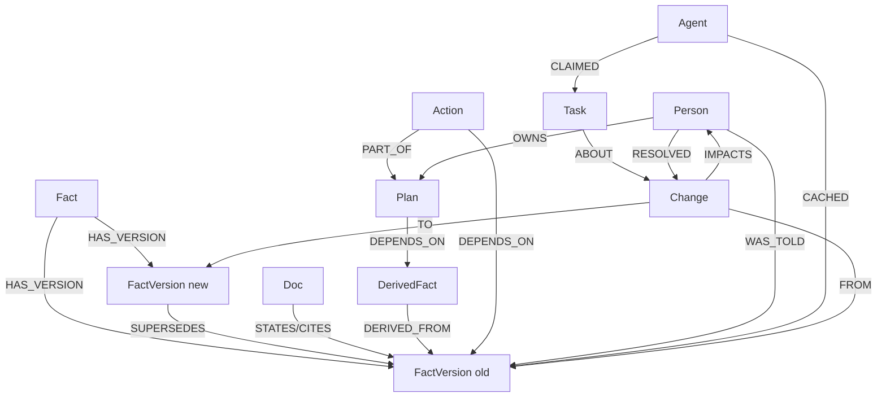
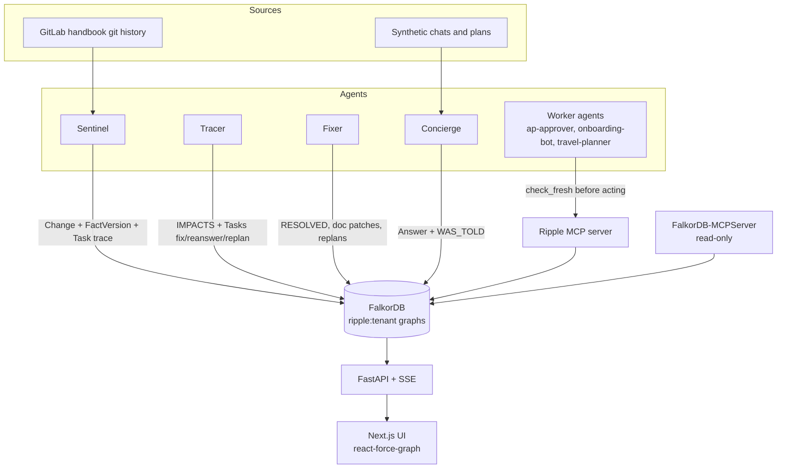
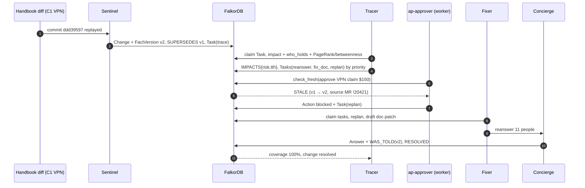
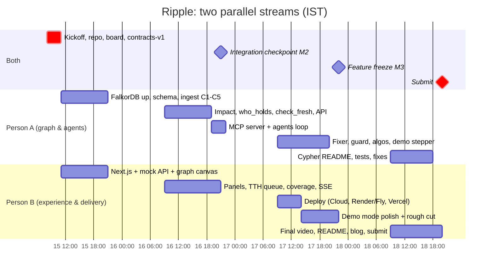

# Ripple: Project Plan

> **The company brain that remembers what it told you, and comes back to fix it when the truth changes.**

**Status:** planning notes only. Hacking starts **Thu Oct 15, 12:01 AM IST**. Submissions close **Sun Oct 18, 11:59 PM IST**.
Everything below (graph model, Cypher, API and MCP schemas) is a **design sketch**. The rules allow sketching the graph model, notes and diagrams before the start. The rules do not allow main coding or design work before Oct 15 12:01 AM IST, so all of it gets implemented, and refined where needed, during the event. **Team: 2 people. Person A = @sahil1330 (graph, data, agents, MCP, API). Person B = @harsh-gupta-10 (web, deploy, docs, demo).**

---

## 1. Pitch

Every company has facts that change: expense limits, approval rules, owners, prices. When a fact changes, the page gets updated. The *people and agents who already absorbed the old version* do not. Most assistants answer from whatever version they last indexed, and they have no memory of what they told whom. **Ripple is a company brain built on FalkorDB that records every fact version it hands out**, to people, to documents and to other agents. When a fact changes, Ripple walks the graph to find everyone and everything still relying on the old version. It ranks them by *time-to-harm*: who is about to act on the stale fact first. Then it acts. It blocks stale actions through a freshness guard, re-answers people, drafts doc fixes, replans dependent work, and tracks coverage until every holder is corrected. Every step has an explainable path.

**Demo data:** real policy changes replayed from the public GitLab handbook's git history, such as "personal VPN subscriptions are no longer reimbursable" (Jul 2026). A clearly labelled synthetic layer of people, chats and plans sits on top.

### 1.1 Why it can win
Judging criteria for this event are **not published**. Past WeMakeDevs events used a consistent rubric: impact, creativity/originality, technical implementation including sponsor-tech integration, UX, presentation (README + demo), and often "best use of <sponsor>". Scrape-Verse said: "Six criteria, weighted equally. The demo is scored as hard as the code" (<https://www.wemakedevs.org/hackathons/scrape-verse>).

| Likely criterion | How Ripple scores |
|---|---|
| Potential impact | Stale policy and process knowledge causes wrong approvals, wrong answers and rework. The demo uses *real* public policy changes, not toy data. |
| Creativity / originality | Plain memory invalidation exists (Graphiti, Lethe). Tracking **who and what absorbed the old version, and correcting them**, is new. I found no hackathon project doing this. |
| Technical implementation | Temporal fact versions, multi-hop impact traversal, 5 cooperating agents with shared graph state, a custom MCP server, and per-tenant graphs. |
| Best use of FalkorDB / rule 3 | The product *is* the graph. Remove FalkorDB and there is no impact set, no holders, no guard. It uses BFS, SSpaths/SPpaths, shortestPath, PageRank, betweenness, WCC and multi-graph tenancy. |
| UX / presentation | One screen: graph lights up red, then turns green; coverage meter; one-click "why" path. Deterministic 2:45 video. |

### 1.2 Track-by-track fit (we enter all three; Company Brain / Mac mini is the priority)

| Track (prize) | Brief keywords | Ripple feature that satisfies it |
|---|---|---|
| **03 Company Brain (M6 Mac mini), PRIORITY** | knowledge from docs, tickets and chats in one graph · who owns / knows what · tracing decisions to source · **keeping knowledge current as things change** · answers with clear sources | Handbook docs + LINKS_TO + chats + plans in one graph. `who_holds()` = who knows which version. Every FactVersion carries commit + MR source. The whole product is "keeping knowledge current". Concierge answers cite version + source URL. |
| 01 Agents That Act on Connected Data (iPhone 18 Pro) | multi-hop reasoning · graph queries/algorithms as agent tools · tool selection through MCP · actions based on what the graph shows · explainable results | Impact = multi-hop traversal. Tracer uses PageRank, betweenness and WCC as tools via our MCP server. The freshness guard **blocks** actions. Fixer re-answers people and replans. `explain_path()` justifies every action. |
| 02 Agent Memory & Coordination (PS5 + GTA VI) | episodic / semantic / procedural memory · persistent history · shared state + handoffs · high-concurrency reads/writes · separate memory per user/tenant | Episodic = WAS_TOLD/CACHED history. Semantic = Fact/FactVersion. Procedural = Fixer playbooks per change type. Agents hand off via `Task` nodes in the graph. One FalkorDB graph per company. Concurrent agent run across tenants shown live. |

Multi-track: rules item 5 says "You may enter any or all of them, and you must name every track you are entering when you submit." **Open question:** can one project *win* more than one track? Ask on the FalkorDB Discord before Oct 15.

---

## 2. Rules compliance checklist
Sources: <https://www.wemakedevs.org/hackathons/falkordb/rules>, <https://www.wemakedevs.org/hackathons/falkordb>

| # | Rule | How we comply | Owner |
|---|---|---|---|
| R1 | Team ≤ 4, one team per person | 2 people, registered as one team on wemakedevs.org | A+B |
| R2 | FalkorDB is the primary graph DB and central | All state (facts, versions, holders, tasks, agent memory) lives in FalkorDB | A |
| R3 | "If the product still works once FalkorDB is taken out, the graph is decoration" | No secondary DB for core state. README has a "What breaks without FalkorDB" section | A |
| R6 | Public, synthetic or own data only | Public GitLab handbook (no login) + synthetic people layer, labelled. **Do not ingest internal links** (e.g., internal-handbook MRs or Loop pages referenced in commits) | A |
| R7/R8 | Main coding and design start after Oct 15 12:01 AM IST | Create the GitHub repo **after** 12:01 AM IST. First commit = these docs. No app code before. Pre-event work stays as notes and diagrams | A+B |
| R9 | Libraries/templates allowed; original work judged | Credit FalkorDB clients, FalkorDB-MCPServer, (optional) Graphiti, Next.js, react-force-graph | B |
| R10 | Public repo + README (setup + **graph data model**) + **Cypher/algorithms used** + demo video + live deployment or local setup + tracks named | README sections: Setup, Data model, Cypher & algorithms, Architecture, Data sources & licence, AI disclosure. Video ≤ 3 min. Live URL + docker compose | B (A writes the Cypher section) |
| R11 | AI coding assistants allowed **but disclosed** | PR template checkbox + README "AI assistance" section listing tools and where they were used | A+B |
| R12/13 | Humans understand the code; not entirely AI-generated | Every merged PR has a human-written summary. Both people walk through the graph model and queries on Day 4 (rehearsal Q&A) | A+B |
| R5 | Name every track at submission | Submit to Track 01, 02 **and** 03 | B |
| R17 | No plagiarism | Cite Graphiti / Lethe / research as prior art in README and blog | B |

---

## 3. Data plan

### 3.1 Source and licence (verified Oct 11, 2026)
- Repo: <https://gitlab.com/gitlab-com/content-sites/handbook> (public, no login). Published at <https://handbook.gitlab.com>.
- `LICENSE` at repo root (<https://gitlab.com/gitlab-com/content-sites/handbook/-/blob/main/LICENSE>): an **MIT-style permission grant, "Copyright (c) 2011-present GitLab B.V.", worded "With regard to the GitLab Software"**.
- **Uncertainty:** the LICENSE text does not explicitly address the handbook *prose*, and I could not see a content licence in the handbook site footer. Rule 6 only requires data to be public and not restricted, and it is. To be safe:
  1. store short excerpts plus links, not page dumps;
  2. attribute GitLab B.V. in the README and UI footer;
  3. optionally ask on Discord.

### 3.2 Real policy changes found in the public git history (all in `content/handbook/finance/expenses.md`)

| ID | Change (old → new) | Date | Commit | MR |
|---|---|---|---|---|
| **C1** | **Personal VPN subscriptions**: "Policy is set at $150 per year" → "Starting July 15, 2026, GitLab no longer reimburses personal VPN subscriptions… use NordLayer" | 2026-07-14 | [`ddd39597`](https://gitlab.com/gitlab-com/content-sites/handbook/-/commit/ddd395971ee181bee9e00d23d34e1001489d76ef) | [!20421](https://gitlab.com/gitlab-com/content-sites/handbook/-/merge_requests/20421) |
| **C2** | **Meals while travelling**: up to **$100**/day → **$120**/day | 2026-06-19 | [`6eb1a977`](https://gitlab.com/gitlab-com/content-sites/handbook/-/commit/6eb1a977ed006bf256e5fdeb7422d06ff14d1cf3) | [!20015](https://gitlab.com/gitlab-com/content-sites/handbook/-/merge_requests/20015) |
| **C3** | **Home internet and mobile phone**: "$80, anything over that amount will still be considered for approval…" → "**$100 - claims above this amount will not be reimbursed**… individual exceptions are no longer assessed" | 2026-06-19 | same as C2 | same as C2 |
| **C4** | **Co-working**: single category → *Monthly* + *Daily Office Pass* with a **$100/day limit**. Later "**Pre-Approval is needed** prior to submitting claims" | 2026-06-19 / 2026-08-31 | `6eb1a977` / [`c72b6af5`](https://gitlab.com/gitlab-com/content-sites/handbook/-/commit/c72b6af5eff911b77604782b2d1f46e95ae9dba0) | !20015 / [!20839](https://gitlab.com/gitlab-com/content-sites/handbook/-/merge_requests/20839) |
| **C5** | **New-hire $1,500 home-office stipend**: issued as a **virtual card** (expires after 1 year, FX at issue date) → "Purchase the items you need using **your own funds and submit a claim** in Navan" | 2026-08-31 | `c72b6af5` | !20839 |
| C6 (spare) | **Flight upgrades**: ">5 hours consecutive flight time" → "(**each segment** must be 5+ hours)". Business-class rule clarified to "minimum 6 flight segments with 8+ hours per segment" | 2024-09-10 | [`90bf2fee`](https://gitlab.com/gitlab-com/content-sites/handbook/-/commit/90bf2fee46a37535c2a36ca3ed682fa411c03cb3) | [!8368](https://gitlab.com/gitlab-com/content-sites/handbook/-/merge_requests/8368) |

I identified each MR number from the "See merge request …" line in the merge commit and verified it in a local clone. **Hero change for the video: C1 (VPN).** It's binary (allowed → not allowed), easy to understand, and makes a perfect "agent about to approve a now-invalid expense" moment. C3 is the second beat: plans that relied on "exceptions will be considered" become invalid.

*How to re-find or extend them during the event:* `git clone --filter=blob:none --no-checkout https://gitlab.com/gitlab-com/content-sites/handbook.git`, then `git log -- content/handbook/finance/expenses.md` and `git show <sha>`. The commits API was behind a Cloudflare challenge from our machine, but git clone worked.

### 3.3 Ingestion design (deterministic for the demo)
1. **Sentinel input:** for each chosen commit, take the old and new text of the changed section, plus the commit SHA, date, MR URL and page URL.
2. **Fact extraction:** an LLM proposes `Fact{key}` and `FactVersion{value, unit, excerpt}` pairs. **For C1–C5, a human verifies them and commits them as fixtures**, so the demo never depends on a live LLM.
3. **Docs graph (real):** handbook pages near the finance section become `Doc` nodes, with hyperlinks as `LINKS_TO` edges (used for PageRank). Pages quoting a policy get `STATES`/`CITES` edges to the version they quote.

### 3.4 Synthetic layer (always labelled `synthetic: true`, disclosed in README and UI)
- **Tenant `handbook-demo`:** 24 people in 5 teams (Accounts Payable, People Ops, IT, Engineering, Sales). Names come from a seeded generator, so the data is reproducible.
- **Concierge transcripts:** about 40 Q&A turns ("Can I expense my ExpressVPN?"). Each one writes `WAS_TOLD {at, channel, answer_id}` to the version it used.
- **Plans and actions:**
  - "Q4 Bengaluru offsite: meal budget" (C2)
  - "Expense approvals queue (AP worker agent)" (C1, C3)
  - "Onboard 3 new hires in Nov: stipend cards" (C5)
  - "EMEA sales trip bookings" (C6)

  Each action has a `due_at` relative to demo time.
- **Worker agents:** `ap-approver` (approves expense claims), `onboarding-bot`, `travel-planner`. Each has `CACHED` edges.
- **Second tenant `acme-synthetic`:** fully synthetic, used to show per-tenant isolation and concurrency.

---

## 4. Graph data model (design sketch)

**Tenancy:** one FalkorDB graph per company: `ripple:<tenant>` (e.g., `ripple:handbook-demo`). FalkorDB supports many isolated graphs in one instance. Every node also gets the label `:Entity` plus a unique `id`, so lookups are indexed.

**Time:** store all times as **epoch-milliseconds integers**. FalkorDB's docs list temporal arithmetic functions as unsupported, so we compare integers. `timestamp()` returns current epoch ms.

### 4.1 Nodes

| Label | Key properties |
|---|---|
| `Fact` | id, key (e.g. `expense.vpn.personal_subscription`), topic, title |
| `FactVersion` | id, fact_key, value, unit, excerpt, valid_from, valid_to (null = current), source_url, commit_sha, mr_url |
| `Change` | id, fact_key, detected_at, commit_sha, mr_url, status (`open`/`resolving`/`resolved`) |
| `Doc` | id, title, url, kind (`handbook`/`faq`/`synthetic_wiki`), synthetic |
| `DerivedFact` | id, statement, derived_at, by_agent (e.g. "offsite meal budget = 3 days × 12 ppl × $100") |
| `Plan` | id, title, status, act_by (epoch ms), synthetic |
| `Action` | id, kind (`approve_expense`/`send_message`/`book_travel`/`issue_card`), status (`pending`/`blocked`/`done`/`replanned`), due_at, amount |
| `Person` | id, name, role, synthetic |
| `Team` | id, name |
| `Agent` | id, name, kind (`sentinel`/`tracer`/`fixer`/`concierge`/`worker`) |
| `Task` | id, kind (`trace`/`fix_doc`/`reanswer`/`replan`/`notify`), status (`open`/`claimed`/`done`/`failed`), priority, risk, created_at, claimed_at, done_at |
| `Answer` | id, question, text, at, channel (episodic memory of the Concierge) |

### 4.2 Relationships (dependent → dependency direction, unless noted)

| Type | From → To | Meaning |
|---|---|---|
| `HAS_VERSION` | Fact → FactVersion | version history |
| `SUPERSEDES` | FactVersion(new) → FactVersion(old) | temporal chain |
| `STATES` / `CITES` | Doc → FactVersion | the doc asserts or quotes this version |
| `LINKS_TO` | Doc → Doc | real handbook hyperlinks (PageRank input) |
| `DERIVED_FROM` | DerivedFact → FactVersion / DerivedFact | derived knowledge |
| `DEPENDS_ON` | Plan / Action → FactVersion / DerivedFact | work relies on the fact |
| `PART_OF` | Action → Plan | |
| `WAS_TOLD {at, channel, answer_id}` | Person → FactVersion / DerivedFact | **episodic exposure** |
| `CACHED {at}` | Agent → FactVersion / DerivedFact | agent memory |
| `OWNS` | Person / Agent → Plan / Action / Doc | ownership |
| `MEMBER_OF` | Person → Team | |
| `TALKS_WITH {weight}` | Person → Person | synthetic chat graph (WCC input) |
| `FROM` / `TO` | Change → FactVersion | old / new version |
| `IMPACTS {hops, risk, tth_ms}` | Change → any | Tracer output (materialised impact set) |
| `RESOLVED {at, by, how}` | any → Change | acknowledged, fixed, re-answered or replanned |
| `FEEDS {w:1}` | dependency → dependent | **materialised reverse edge**, written alongside each dependency edge, so `algo.bfs` / `algo.SSpaths` can run over a single relationship type |
| `ABOUT` / `TARGETS` | Task → Change / any | handoff context |
| `CREATED` / `CLAIMED` | Agent → Task | handoffs |



### 4.3 Indexes (syntax checked against docs.falkordb.com/cypher/indexing)
```cypher
CREATE INDEX FOR (e:Entity) ON (e.id)
CREATE INDEX FOR (f:Fact) ON (f.key)
CREATE INDEX FOR (v:FactVersion) ON (v.valid_to)
CREATE INDEX FOR (t:Task) ON (t.status)
CREATE INDEX FOR (a:Action) ON (a.status)
CREATE INDEX FOR ()-[r:WAS_TOLD]-() ON (r.at)
CALL db.idx.fulltext.createNodeIndex('Doc', 'title')
```

### 4.4 Core queries (design drafts, to be implemented and tested after Oct 15)
Parameters use `$name`. In FalkorDB, parameters are not allowed in `LIMIT`/`SKIP` (per the FalkorDB-MCPServer README).

**(a) Impact radius: pure Cypher, multi-type variable-length**
```cypher
MATCH (old:FactVersion {id: $old_id})
MATCH p = (old)<-[:STATES|CITES|DERIVED_FROM|DEPENDS_ON|PART_OF|WAS_TOLD|CACHED|OWNS*1..6]-(x)
WITH x, min(length(p)) AS hops
RETURN labels(x) AS labels, x.id AS id, coalesce(x.name, x.title, x.statement) AS label, hops
ORDER BY hops
```

**(a') Impact radius: `algo.bfs` over the materialised `FEEDS` edge** (signature from docs: `algo.bfs(start_node, max_depth, relationship) YIELD nodes, edges`; one relationship type only)
```cypher
MATCH (old:FactVersion {id: $old_id})
CALL algo.bfs(old, 6, 'FEEDS') YIELD nodes
UNWIND nodes AS n
RETURN DISTINCT n.id AS id, labels(n) AS labels
```

**(a'') Hop distance per dependent: `algo.SSpaths`** (config-map signature from docs)
```cypher
MATCH (old:FactVersion {id: $old_id})
CALL algo.SSpaths({sourceNode: old, relTypes: ['FEEDS'], weightProp: 'w',
                   maxLen: 6, relDirection: 'outgoing', pathCount: 1})
YIELD path, pathWeight
WITH last(nodes(path)) AS x, pathWeight AS hops
RETURN x.id AS id, labels(x) AS labels, hops
```

**(b) `who_holds(version)`: people and agents still holding a superseded version**
```cypher
MATCH (v:FactVersion {id: $version_id})<-[:HAS_VERSION]-(:Fact)-[:HAS_VERSION]->(cur:FactVersion)
WHERE cur.valid_to IS NULL AND cur.id <> v.id
MATCH (h)-[r:WAS_TOLD|CACHED]->(v)
WHERE ('Person' IN labels(h) OR 'Agent' IN labels(h))
OPTIONAL MATCH (h)-[ack:RESOLVED]->(:Change)-[:TO]->(cur)
WITH h, r, cur, ack WHERE ack IS NULL
RETURN h.id AS id, h.name AS name, labels(h) AS labels, type(r) AS how, r.at AS at, r.channel AS channel, cur.id AS current_version
ORDER BY at DESC
```

**(c) `check_fresh(plan)`: the freshness guard** (an empty result means fresh; any row means stale)
```cypher
MATCH (pl:Plan {id: $plan_id})-[:DEPENDS_ON]->(d)
MATCH (d)-[:DERIVED_FROM*0..5]->(fv:FactVersion)
WHERE fv.valid_to IS NOT NULL AND fv.valid_to <= $now
MATCH (cur:FactVersion)-[:SUPERSEDES*1..10]->(fv)
WHERE cur.valid_to IS NULL
RETURN pl.id AS plan, d.id AS via, fv.id AS stale_version, cur.id AS current_version,
       fv.value AS stale_value, cur.value AS current_value, cur.source_url AS source
```
The same query with `(a:Action {id:$action_id})` and `[:DEPENDS_ON|PART_OF*1..3]` guards single actions.

**(d) `explain_path(from, to)`: why is X affected?** (`shortestPath` endpoints must be bound first, and no property filters are allowed inside the pattern, per docs)
```cypher
MATCH (src:Entity {id: $from_id}), (dst:Entity {id: $to_id})
WITH shortestPath((src)-[:WAS_TOLD|CACHED|OWNS|PART_OF|DEPENDS_ON|DERIVED_FROM|STATES|CITES*1..8]->(dst)) AS p
RETURN [n IN nodes(p) | coalesce(n.name, n.title, n.statement, n.id)] AS hops,
       [r IN relationships(p) | type(r)] AS via
```
Weighted alternative: `CALL algo.SPpaths({sourceNode: src, targetNode: dst, relTypes: ['FEEDS'], weightProp: 'w', relDirection: 'incoming', pathCount: 1}) YIELD path, pathWeight`

**(e) `coverage(change)`**
```cypher
MATCH (c:Change {id: $change_id})-[i:IMPACTS]->(x)
OPTIONAL MATCH (x)-[r:RESOLVED]->(c)
WITH labels(x)[1] AS kind, count(i) AS impacted, count(r) AS resolved
RETURN kind, impacted, resolved
```
`labels(x)[1]` assumes `:Entity` is the first label. Implement as a property `kind` instead if label order is not stable.

**(f) Algorithms as agent tools** (signatures from docs.falkordb.com/algorithms)
```cypher
// Doc authority: which docs spread a stale fact furthest (real handbook links)
CALL algo.pageRank('Doc', 'LINKS_TO') YIELD node, score
RETURN node.id, score ORDER BY score DESC LIMIT 10

// Amplifiers: who or what relays stale info between parts of the org
CALL algo.betweenness({nodeLabels: ['Person','Agent','Doc','DerivedFact','Plan'],
                       relationshipTypes: ['FEEDS'], samplingSize: 64, samplingSeed: 42})
YIELD node, score
RETURN node.id, score ORDER BY score DESC LIMIT 10

// Dark pockets: groups of people none of whom has acknowledged the new version
CALL algo.WCC({nodeLabels: ['Person'], relationshipTypes: ['TALKS_WITH']})
YIELD node, componentId
RETURN componentId, collect(node.id) AS members
```
The app then checks, per component, whether any member has `RESOLVED` the change. Components with none become "dark pockets", and Fixer briefs the highest-betweenness member of each.

**Syntax uncertainties to test in the first hour of Oct 15:**

| Item | Uncertainty | Fallback |
|---|---|---|
| (a) | Multi-type variable-length patterns `[:A\|B*1..6]` are standard openCypher, but the FalkorDB docs page lists "label expressions" as unsupported. Relationship type alternation is a different feature but untested | the `FEEDS` + `algo.bfs` path |
| `algo.bfs` | Traversal direction (outgoing only?) is not stated in the docs | Write `FEEDS` dependency → dependent so outgoing is correct |
| WCC procedure name | Docs show both `algo.wcc` and `algo.WCC` | Test both |
| SPpaths/SSpaths `weightProp` | Appears in the syntax as required | Set `w: 1` on every `FEEDS` edge |
| `*0..5` zero-length variable patterns | Not confirmed | Fallback: `UNION` of a direct match and a `*1..5` match |
| `labels()` membership checks in WHERE | Used instead of label expressions; should work but untested | |
| `algo.pageRank` arguments | Positional `(label, relType)` per docs | |
| Known limitation | When a relationship is not referenced elsewhere, FalkorDB only verifies existence | Always reference relationship aliases (`i`, `r`) in RETURN/WITH when counting |

---

## 5. Agents



| Agent | Responsibility | Reads | Writes |
|---|---|---|---|
| **Sentinel** | Watches handbook diffs (replayed commits). Creates `Change`, the new `FactVersion`, `SUPERSEDES`, sets the old `valid_to`, opens a `Task{kind:'trace'}` | commit diff, fixtures | Change, FactVersion, Task |
| **Tracer** | Claims trace tasks. Runs impact (a/a'/a''), who_holds (b) and the algorithms (f). Computes **time-to-harm**. Writes `IMPACTS` and opens fix/reanswer/replan/notify tasks in priority order | graph | IMPACTS, Tasks |
| **Fixer** | Claims tasks by priority. *reanswer*: Concierge re-sends the corrected answer with the source. *fix_doc*: drafts a markdown patch (shown as a diff in the UI, never pushed upstream). *replan*: recomputes the DerivedFact and plan, and marks the old action `replanned`. *notify*: briefs a dark-pocket hub. Writes `RESOLVED` | graph, procedural playbooks per fact type | RESOLVED, new DerivedFact, Action status |
| **Concierge** | User-facing Q&A. Answers **only** from the current FactVersion (cited). Logs `Answer` + `WAS_TOLD` for every answer (episodic memory). Re-answers on Fixer's request | graph | Answer, WAS_TOLD |
| **Worker agents** | Do "real work" (approve expenses, issue cards, book travel). **Must call `check_fresh` before every action.** Stale → action `blocked`, `Task{kind:'replan'}` handed to Fixer | MCP | Action status |

**Shared state and handoffs:** agents never message each other directly. All coordination goes through `Task` nodes:
1. The creator writes `(agent)-[:CREATED]->(t:Task {status:'open', priority, risk})-[:ABOUT]->(change)` and `-[:TARGETS]->(entity)`.
2. A worker claims it atomically:
   ```cypher
   MATCH (t:Task {id:$id, status:'open'}) SET t.status='claimed', t.claimed_at=$now
   WITH t MATCH (a:Agent {id:$agent}) CREATE (a)-[:CLAIMED]->(t) RETURN t
   ```
   No row returned means another agent claimed it first. FalkorDB executes write queries one at a time per graph; confirm that on Day 1 and add a version check if not.
3. On completion: `status:'done'`, plus `RESOLVED` written on the target.

The UI's SSE stream is driven by these state transitions.

**Time-to-harm (TTH) ranking:**
`risk(x) = severity(kind) × urgency(x) × (1 + reach(x))`

- `urgency = 1 / max(1h, due_at − now)` for pending Actions and Plans. People inherit the soonest due action they own. For docs and agents, urgency is derived from their next expected use (default 24h).
- `severity`:
  - pending Action that moves money or messages: 1.0
  - Plan: 0.7
  - Agent `CACHED` (it will repeat the error to many people): 0.6
  - Person `WAS_TOLD`: 0.5
  - Doc: 0.4
- `reach`: normalised PageRank (Docs) or betweenness (everything else).

The UI shows the factors, so the ranking is explainable ("blocked first because it auto-approves in 40 minutes").



---

## 6. MCP tools

**Ours: `ripple-mcp`** (Python MCP SDK, stdio for local agents plus HTTP for the deployed demo). Every tool takes `tenant` and is read-only unless marked **write**.

| Tool | Params | Returns |
|---|---|---|
| `impact_of` | `tenant, change_id \| version_id, max_hops=6` | `[{id, kind, label, hops, risk, tth_ms}]` |
| `who_holds` | `tenant, version_id` | `[{id, name, kind, how: WAS_TOLD\|CACHED, at, channel}]` |
| `check_fresh` | `tenant, plan_id \| action_id, now?` | `{fresh: bool, stale: [{via, stale_version, current_version, stale_value, current_value, source}]}` |
| `explain_path` | `tenant, from_id, to_id` | `{hops: [..], via: [..], cypher}` |
| `coverage` | `tenant, change_id` | `{impacted, resolved, pct, by_kind: {...}}` |
| `rank_amplifiers` | `tenant, change_id, algo: pagerank\|betweenness, k=10` | `[{id, score}]` |
| `dark_pockets` | `tenant, change_id` | `[{component_id, members, hub_id}]` |
| `claim_task` (**write**) | `tenant, agent_id, kinds[]` | `Task \| null` |
| `complete_task` (**write**) | `tenant, task_id, outcome` | `{ok}` |
| `record_answer` (**write**) | `tenant, person_id, question, version_ids[]` | `{answer_id}` |

**FalkorDB-MCPServer** (<https://github.com/FalkorDB/FalkorDB-MCPServer>, npm `@falkordb/mcpserver`), run with `FALKORDB_DEFAULT_READONLY=true` for exploratory and judge-facing queries. Documented tools: `query_graph` (with `readOnly`, `params`), `query_graph_readonly`, `list_graphs`, `get_graph_schema`, `get_node_schema`, `get_relationship_schema`, plus create/delete operations, which we disable via read-only mode. **Demo line:** "Any MCP client can ask Ripple's graph who still believes the old VPN policy."

---

## 7. Tech stack (lean)

| Layer | Choice | Why |
|---|---|---|
| Graph | **FalkorDB** (Docker locally, **FalkorDB Cloud** for deploy) | Required. Multi-graph tenancy, `algo.*` |
| Backend | **Python 3.12, FastAPI**, official `falkordb` Python client, SSE via `sse-starlette` | Fast to build. Python has the best agent and MCP tooling |
| Agents | **Plain Python loop over Task nodes** (LangGraph optional) | Coordination lives in the graph, so it stays simple and deterministic |
| LLM | Provider-agnostic (env var), used only for Concierge phrasing and fact proposals | Demo path is deterministic. Fixtures are pre-verified |
| MCP | `mcp` Python SDK for `ripple-mcp` + FalkorDB-MCPServer (npx) | Track 01 "tool selection through MCP" |
| Temporal memory | **Own FactVersion model.** Graphiti optional, credited (it supports FalkorDB) | Avoids Graphiti's open invalidation issues (#1728, #1841) and time risk |
| Frontend | **Next.js + react-force-graph-2d**, Tailwind | Fastest path to a striking live graph |
| Deploy | FalkorDB Cloud + **Render or Fly.io** (API + agents) + **Vercel** (web) | Free or cheap tiers, quick setup |
| CI | GitHub Actions: ruff + pytest (backend), eslint + typecheck + build (web), Cypher smoke tests against a FalkorDB service container | |

---

## 8. UI (single page, three regions + demo mode)

1. **Graph canvas (centre, about 65% width).** react-force-graph with nodes coloured by kind. When a Change fires, impacted nodes pulse **red**, sized by risk. As `RESOLVED` events arrive, they turn **green**. Clicking a node opens the "Why?" drawer (`explain_path`, showing the hops plus the Cypher used). A small badge marks synthetic nodes.
2. **Before / after panel (right).** Old vs new FactVersion side by side with a diff highlight, the source link (commit + MR), and the effective date. Below it is the **time-to-harm queue**, ranked: entity, why (factors), status (blocked / re-answered / patched / replanned).
3. **Coverage meter (top bar).** 0 → 100% with per-kind counts (people, agents, docs, plans). Tenant switcher. "Live agents" ticker from SSE (Task created / claimed / done).
4. **Ask panel (bottom drawer).** Talk to the Concierge as a chosen person. Answers show the cited version and source. Asking again after a fix shows the corrected answer and the "Ripple told you earlier: v1; corrected at 12:04" memory line.
5. **Demo mode** (`?demo=1`). A stepper (Next ▶) drives the deterministic scenario through `/api/demo/step`, with a reset button. Used for video recording and live judging.

---

## 9. Demo script (target 2:45, recorded twice, best take + backup)

| # | Time | Shot | Say / show |
|---|---|---|---|
| 1 | 0:00–0:15 | Title card + tagline | "When a company policy changes, the page gets updated. The people and agents who already learned the old version don't." |
| 2 | 0:15–0:35 | Ask panel as Priya (synthetic): "Can I expense my ExpressVPN?" → Concierge: "Yes, up to $150/year" (cited v1, pre-change state). Graph shows the WAS_TOLD edge appear | "Ripple remembers what it told you, and which version." |
| 3 | 0:35–0:55 | Sentinel replays real commit `ddd39597` / MR !20421. Before/after panel flips to "no longer reimbursed, use NordLayer" | "This is a real change from GitLab's public handbook, July 2026." |
| 4 | 0:55–1:20 | Graph lights up: 11 people, 2 agents, 3 docs, 1 plan in red. TTH queue ranks the `ap-approver` action first: "auto-approves in 40 min" | "Multi-hop impact in one FalkorDB traversal: who was told, what cached it, what was derived from it." |
| 5 | 1:20–1:40 | **Hero moment:** the worker agent tries to approve a $150 VPN claim → `check_fresh` → **BLOCKED** with the path and source | "Agents can't act on stale facts. Every tool call goes through the freshness guard over MCP." |
| 6 | 1:40–2:05 | Fixer works the queue: Concierge re-answers people, doc patch diff shown, dark-pocket hub briefed (WCC + betweenness). Coverage meter 0 → 100%, red → green | "Agents hand off through Task nodes in the graph. Shared state, no glue code." |
| 7 | 2:05–2:20 | Priya asks again → correct answer + "Earlier I told you $150/yr; that changed on Jul 15 (MR !20421)" | "Memory that corrects itself." |
| 8 | 2:20–2:35 | Click "Why?" on any node → explain_path + Cypher. Quick tenant switch shows isolation + concurrent agents | "Every decision is traceable. One graph per company." |
| 9 | 2:35–2:45 | Track badges (01/02/03) + repo URL + "Built on FalkorDB" | |

Determinism: seeded fixtures, fixed `now` in demo mode, templated LLM fallback text, and a pre-warmed backend. Record a local run *and* a deployed run, and keep the better one plus the other as backup.

---

## 10. Two-person plan (Oct 15–18 IST)

### 10.1 Split (and why)

| | **Person A: Graph & Agents (backend brain)** | **Person B: Experience & Delivery** |
|---|---|---|
| Owns | `graph/` (schema, Cypher), `ingest/`, `agents/`, `ripple_mcp/`, `api/`, `fixtures/` (A writes, B reviews) | `web/`, `deploy/`, `docs/` (README, blog), demo video, `.github/` |
| Why | All FalkorDB and Cypher knowledge stays in one head, so the schema stays consistent and query bugs get fixed fast | Judges see the demo first. A dedicated owner makes the UI, video and docs outstanding instead of rushed on Day 4 |

Collisions are minimised by (1) a **contracts-first** morning on Day 1, (2) B building entirely against **mock fixtures** until A's API is live, and (3) CODEOWNERS plus one-assignee issues (see `docs/WORKFLOW.md`).

### 10.2 Day 1 contracts (merged by ~11:00 IST Oct 15; both must approve; tag `contracts-v1`)
- `contracts/graph-model.md`: labels, relationship types, properties (§4).
- `contracts/openapi.yaml`:
  - `GET /api/tenants`
  - `GET /api/graph?tenant&change_id` → `{nodes:[{id,kind,label,synthetic,risk,status}], links:[{source,target,type}]}`
  - `GET /api/changes?tenant`
  - `GET /api/changes/{id}` (before/after + source)
  - `GET /api/changes/{id}/impact` (TTH queue)
  - `GET /api/changes/{id}/coverage`
  - `GET /api/explain?tenant&from&to`
  - `POST /api/ask {tenant, person_id, question}` → `{answer, versions[], source_url, earlier_told?}`
  - `POST /api/demo/step {tenant, scenario}`, `POST /api/demo/reset`
- `contracts/events.md`: SSE `GET /api/stream?tenant`. Events: `change.detected`, `impact.computed`, `task.created`, `task.claimed`, `task.done`, `action.blocked`, `answer.sent`, `coverage.updated` (each `{type, at, tenant, payload}`).
- `contracts/mcp-tools.json`: the §6 tool schemas.
- `fixtures/demo-c1/*.json`: canonical responses for every endpoint for the C1 scenario, plus a scripted SSE event log. **B's mock server replays these; A's tests assert real responses match their shape.**

Rule: changing a contract needs a PR labelled `contract` and approval from both people.

### 10.3 Schedule



| Day (IST) | Person A | Person B | Milestone (both) |
|---|---|---|---|
| **Thu Oct 15** | After 12:01 AM: create repo + push docs. FalkorDB in Docker. Run the syntax-uncertainty smoke tests (§4.4) first. Schema + indexes. Ingest C1–C5 (verified fixtures) + handbook Docs/LINKS_TO. Synthetic generator (seeded). Answer contract questions fast | Board + labels + branch protection + CI skeleton. Next.js app, mock API from `fixtures/`, graph canvas rendering the fixture graph. First Vercel deploy. Create the FalkorDB Cloud instance | **M1 (22:00):** real graph loaded locally; deployed UI renders the mock graph |
| **Fri Oct 16** | Queries (a–f) behind FastAPI; Concierge + WAS_TOLD logging; TTH ranking; SSE emitter; `ripple-mcp` tools (read-only first) | Before/after panel, TTH queue, coverage meter, explain drawer, Ask panel, SSE client against the scripted log. Switch to the real API behind a flag | **M2 (21:00):** C1 end-to-end on localhost: change → impact → UI from the real API |
| **Sat Oct 17** | Fixer + worker agents + `check_fresh` guard + Task handoffs. Algorithms (PageRank, betweenness, WCC dark pockets). Demo stepper with fixed `now`. Second tenant + concurrency run | Deploy API/agents (Render/Fly) + FalkorDB Cloud seed. Demo mode UI. Visual polish (pulse, colour transitions). Record a rough cut; collect bugs as issues | **M3 (22:00): feature freeze.** Full demo runs on the deployed URL |
| **Sun Oct 18** | Bug fixes only. README "Data model" + "Cypher & algorithms" + "What breaks without FalkorDB". Tests green | Final video (2 takes + backup), README top + setup + AI disclosure, blog post, submission form naming **all 3 tracks** | 18:00 code freeze → **20:00 submit** → buffer until 23:59 |

**Daily syncs (15 min):** 09:00, 14:00 and 21:00 IST. Walk the board, then each person says what's blocked and what's next.

### 10.4 Cut-lines (drop from the top if behind at any checkpoint)
1. Concurrency benchmark across 5 tenants → show 2 tenants only.
2. WCC dark pockets → skip, keep PageRank + betweenness.
3. MCP HTTP transport → stdio only; demo via our agents + FalkorDB-MCPServer locally.
4. Graphiti integration (already optional) → none.
5. Doc patch generation → static diff from fixtures.
6. Live LLM phrasing → templated text.
7. C2–C5 scenarios → C1 only, plus C3 as the second beat if time allows.

**Never cut:** impact graph + red→green, `check_fresh` block, coverage meter, explain path, README Cypher + data model, AI disclosure, video, live URL (or full docker-compose).

### 10.5 Allowed prep before Oct 15 (notes and diagrams only, no app code, no repo commits)
- [ ] Register both people as one team on wemakedevs.org/hackathons/falkordb
- [ ] Ask on FalkorDB Discord: "Can one project win more than one track prize?" and "When are results and the kickoff session?"
- [ ] Read this plan together. Agree the A/B split and the contract list (names only)
- [ ] Sketch the graph model on paper or a whiteboard (§4) and refine labels
- [ ] Re-read handbook commits C1–C5 and choose the hero (C1) + second beat (C3)
- [ ] Draft the demo script wording (§9) and storyboard frames
- [ ] Watch: "Write effective Cypher queries" (<https://www.youtube.com/watch?v=emUQmEitSGY>), "Advanced graph algorithms" (<https://www.youtube.com/watch?v=aFkgUT0ubYY>)
- [ ] Accounts ready: GitHub org/repo name reserved (don't create the repo yet), FalkorDB Cloud, Vercel, Render/Fly, LLM API key
- [ ] Install Docker, `docker pull falkordb/falkordb:latest`, Node 20, Python 3.12
- [ ] Keep `docs/WORKFLOW.md`, `docs/AGENT_REVIEW.md`, `docs/BACKLOG.md` and the `.github/` templates ready to commit right after 12:01 AM IST

---

## 11. Risks and mitigations

| Risk (how a judge attacks) | Mitigation |
|---|---|
| "Who-believes-what data is fake" | Exposure comes only from observable events: our own answer log (`WAS_TOLD`), agent memory reads (`CACHED`), real handbook links and quotes. Synthetic people are labelled in the UI and README |
| "It's just a notification system" | It **acts**: blocks stale actions (guard), replans, re-answers, patches docs, verifies coverage to 100% |
| "Graphiti already invalidates facts" | Invalidation is step 1. Ripple's contribution is **propagation to holders and dependents**. Graphiti is credited as related work |
| "Lethe already did stale knowledge" | Lethe forgets inside its own store. Ripple corrects *everyone who already absorbed* the stale fact |
| Graph not essential | Multi-hop dependency chains + per-tenant graphs + algorithms. README section "What breaks without FalkorDB" |
| Demo flakiness (LLM, network) | Deterministic stepper, fixed `now`, pre-verified fixtures, templated fallback, recorded backup video |
| Cypher feature gaps (label expressions, temporal arithmetic) | Epoch-ms integers, `labels()` checks, `FEEDS` edges for algorithms. Smoke-test in hour 1 of Day 1 |
| Two-person bandwidth | Contracts-first + mocks. Cut-lines. Freeze at M3 |
| Surveillance concern | Ripple logs only what the system itself told people + public artefacts. Opt-in, per-tenant |
| Licence ambiguity of handbook prose | Excerpts + links + attribution. Public data per rule 6. Ask on Discord if needed |
| Rule 8 timing | Repo created after 12:01 AM IST Oct 15. Pre-event material stays as notes and diagrams |

---

## 12. Blog post outline (AirPods 5 side prize)
**Title:** "Your AI told me the old policy. Here's how we made it come back and fix it (FalkorDB + agents)"

1. The bug nobody tracks: stale knowledge in people's heads and agents' caches. Open with the real GitLab VPN policy change.
2. Why a graph: exposure → derived facts → plans → actions is a dependency graph. Show the 6-line impact Cypher.
3. Data model walkthrough (diagram): FactVersion + SUPERSEDES, WAS_TOLD as episodic memory.
4. Algorithms as agent tools: BFS/SSpaths for impact, PageRank for doc authority, betweenness for amplifiers, WCC for dark pockets.
5. Agents that coordinate through the graph: Task nodes, atomic claims, the freshness guard over MCP.
6. Demo GIF: red → green coverage.
7. What we learned (FalkorDB gotchas we hit, e.g. epoch-ms times, single-relationship BFS) + prior art credit (Graphiti, Lethe, PlanFence/STALE papers).
8. Links: repo, video, live demo. AI-assistance disclosure.

---

## Appendix: sources
- Event, rules, schedule, resources: <https://www.wemakedevs.org/hackathons/falkordb> (+ `/rules`, `/schedule`, `/resources`)
- FalkorDB algorithms: <https://docs.falkordb.com/algorithms/> (bfs, sppath, sspath, pagerank, betweenness-centrality, wcc). Cypher support and limitations: <https://docs.falkordb.com/cypher/cypher-support>, <https://docs.falkordb.com/cypher/known-limitations>. Indexing: <https://docs.falkordb.com/cypher/indexing>
- FalkorDB-MCPServer: <https://github.com/FalkorDB/FalkorDB-MCPServer>
- GitLab handbook repo + LICENSE: <https://gitlab.com/gitlab-com/content-sites/handbook>
- Prior art: Lethe (<https://www.wemakedevs.org/blogs/hangover-wrap-up-blog>), Graphiti (<https://github.com/getzep/graphiti>), PlanFence (<https://arxiv.org/abs/2609.03340>), STALE (<https://arxiv.org/html/2605.06527v1>)
