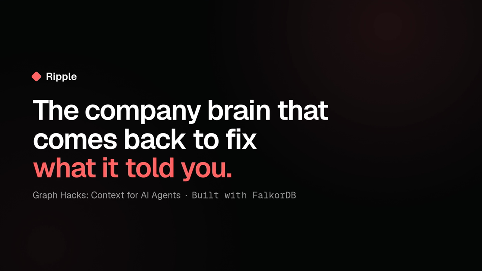
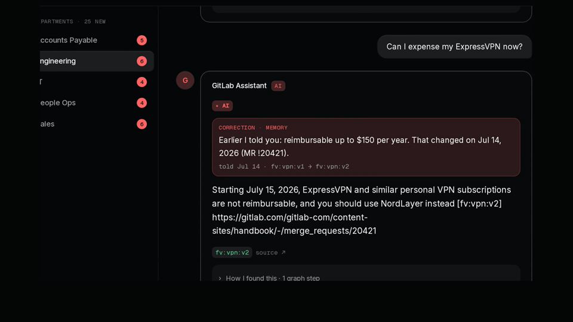
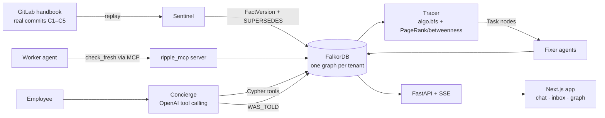
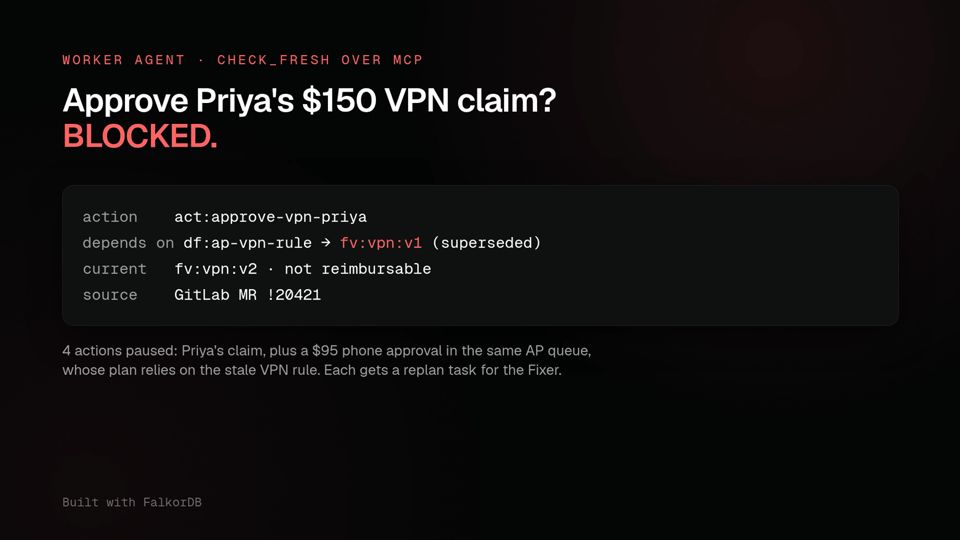
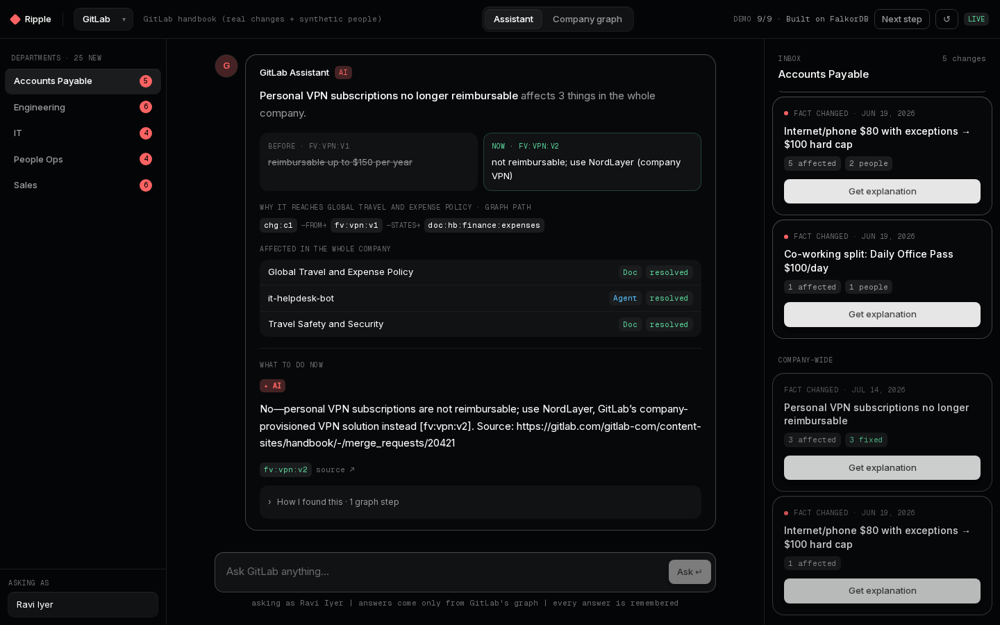
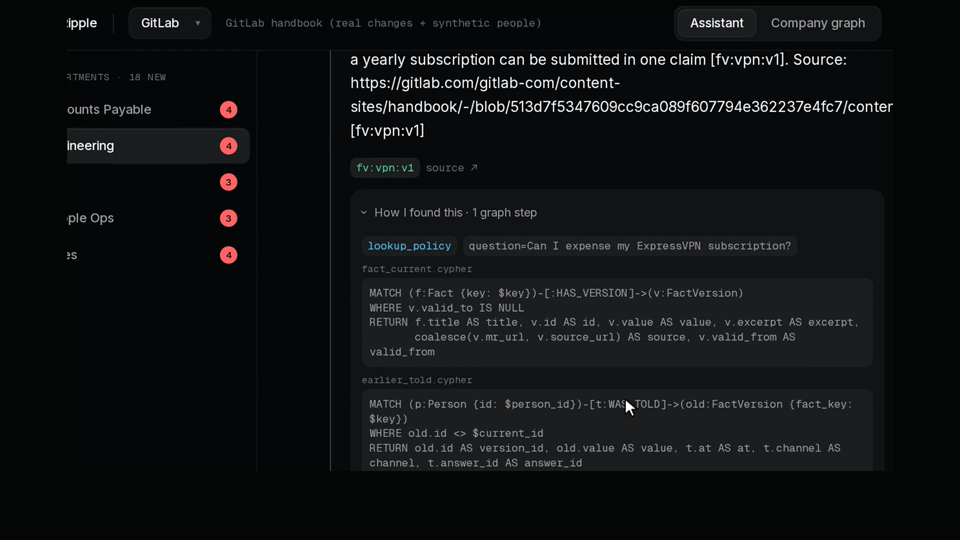

# Your AI Told Me the Old Policy. So We Built One That Comes Back to Fix It

*How Ripple uses FalkorDB to remember who was told what, and to come back and correct them when a policy changes.*

**Team:** Sahil Mane ([@sahil1330](https://github.com/sahil1330)) and Harsh Gupta ([@harsh-gupta-10](https://github.com/harsh-gupta-10))
**Hackathon:** WeMakeDevs × FalkorDB, *Graph Hacks: Context for AI Agents* (Oct 15–18, 2026), all three tracks
**Live app:** [ripple-2.up.railway.app](https://ripple-2.up.railway.app) · **Code:** [github.com/sahil1330/ripple](https://github.com/sahil1330/ripple) · **Demo video:** _YouTube link coming soon_



---

## TL;DR

- Company policies change. The **people and AI agents who learned the old answer keep acting on it**, and nothing tells them otherwise.
- **Ripple** is a company's own AI assistant. It answers from a FalkorDB graph, **records every answer it gives** (`WAS_TOLD`), and when a fact changes it **finds everyone affected, blocks stale agent actions, and comes back to fix them**.
- It runs on a **real change**: GitLab's handbook stopped reimbursing personal VPNs (MR !20421).
- On our own evaluation set of **31 questions**, the LLM agent scored **100% with 0 hallucinations**, at a **p50 latency of about 1.66 s**.

---

## 1. The bug nobody tracks: stale answers

On **Jul 14, 2026**, GitLab merged [MR !20421](https://gitlab.com/gitlab-com/content-sites/handbook/-/merge_requests/20421) (commit `ddd39597`) into its public handbook. Before it, personal VPN subscriptions were *reimbursable up to $150 per year*. After it, starting **Jul 15, 2026**, they are *not reimbursable; use NordLayer, the company VPN*.

The page got updated, and as far as most tools are concerned that's the end of the story. Now think about everything that still holds the old answer:

- **Priya**, an engineer, asked the company assistant "Can I expense my ExpressVPN?" and was told **"yes, up to $150"**.
- An **accounts-payable worker agent** has a cached rule, *"auto-approve personal VPN claims up to $150/year"*, and Priya's $150 claim sits in its queue, due in 40 minutes.
- Internal wiki pages and FAQ copies **still cite the old rule**.

Search can find the new page. A vector index can embed it. **Neither of them knows who was told the old version.** That is a relationship problem, so we solved it with a graph.

> In our seeded demo company, **24 people, agents, docs, plans and actions** depend on that one old fact.

---

## 2. What Ripple does, in one minute

1. **Ask.** Priya asks the assistant. It answers with citations, and the graph records `(Priya)-[:WAS_TOLD]->(VPN v1)`.
2. **Change.** *Sentinel* replays the real handbook commit and writes `FactVersion v2`, which `SUPERSEDES` v1.
3. **Trace.** *Tracer* finds all 24 affected entities in one traversal and ranks them by **time-to-harm**.
4. **Guard.** The AP worker agent calls `check_fresh` over **MCP** before acting. The graph shows its rule derives from a superseded version, so the action is **BLOCKED**.
5. **Fix.** *Fixer* agents claim `Task` nodes, patch docs, refresh caches, replan and re-brief. Coverage reaches **100% (24/24)**.
6. **Correct.** Priya asks again, and the answer opens with: **"Earlier I told you: reimbursable up to $150 per year. That changed on Jul 14, 2026 (MR !20421)."**



---

## 3. Architecture



- **Backend:** Python and FastAPI. Every query is a parameterised `.cypher` file in `graph/queries/`, loaded by name.
- **Agents:** Sentinel, Tracer, Fixer, a worker (`ap-approver`), and the Concierge LLM agent.
- **MCP:** the `ripple_mcp` server exposes read-only graph tools (`check_fresh`, `who_holds`, `explain_path`, `impact_of`, `coverage`, ...).
- **Frontend:** Next.js with a Raycast-style UI: a chat with the company assistant, a per-department inbox with **Get explanation**, and a graph tab.
- **Deploy:** Railway (FalkorDB, API and web).

---

## 4. The graph model

Every node carries `:Entity` plus one main label, an `id` prefixed by kind (`fv:vpn:v1`), and epoch-ms times. `valid_to = null` marks the current version.

```
(Fact)-[:HAS_VERSION]->(FactVersion)          (v2)-[:SUPERSEDES]->(v1)
(Change)-[:FROM]->(v1)  (Change)-[:TO]->(v2)  (Doc)-[:STATES|CITES]->(FactVersion)
(Person)-[:WAS_TOLD {at, channel}]->(FactVersion)
(Agent)-[:CACHED]->(FactVersion)              (DerivedFact)-[:DERIVED_FROM]->(FactVersion)
(Plan)-[:DEPENDS_ON]->(DerivedFact)           (Action)-[:PART_OF]->(Plan)
(Person)-[:MEMBER_OF]->(Team)                 (Agent)-[:OWNS]->(Plan|Action)
(Task)-[:ABOUT]->(Change)  (Task)-[:TARGETS]->(x)  (Agent)-[:CREATED|CLAIMED]->(Task)
(Change)-[:IMPACTS {hops, risk, tth_ms}]->(x) (Person)-[:RESOLVED {at, by, how}]->(Change)
```

Dependency edges point **dependent → dependency** (Priya `WAS_TOLD` v1). Ingest mirrors each one with a `FEEDS {w:1}` edge in the opposite direction, so graph algorithms, which follow outgoing edges only, can ask "what does this version feed?" over a single relationship type.

**Data:** the fact versions are real. They come from five changes (C1–C5) to GitLab's `finance/expenses.md`, and the docs are 74 real handbook finance pages with their links. The people and agents holding those versions are synthetic and seeded: 24 people, 8 agents, plans, actions and answers.

---

## 5. Why this needs FalkorDB (with the real Cypher)

### 5.1 Blast radius in one traversal

The Tracer's whole impact set is one query (`impact_bfs.cypher`):

```cypher
MATCH (old:FactVersion {id: $old_id})
CALL algo.bfs(old, 6, 'FEEDS') YIELD nodes
UNWIND nodes AS x
MATCH p = (old)-[:FEEDS*1..6]->(x)
WITH x, min(length(p)) AS hops
WHERE NOT 'FactVersion' IN labels(x)
RETURN x.id AS id, x.kind AS kind,
       coalesce(x.name, x.title, x.statement, x.id) AS label, hops
ORDER BY hops, id
```

For C1 it returns **24 entities** with their hop distance: people who were told, agents that cached the rule, the derived auto-approve rule, the plan and actions behind it, and docs that cite it.

### 5.2 Graph algorithms as ranking tools

Not everything is equally urgent. Ripple's **time-to-harm** ranking is:

```
risk(x) = severity(kind) × urgency(x) × (1 + reach(x))
```

*Severity* runs from a money-moving Action (1.0) down to a Doc (0.4). *Urgency* comes from deadlines, inherited through `OWNS`. *Reach* comes straight from FalkorDB's algorithms:

```cypher
CALL algo.pageRank('Doc', 'LINKS_TO') YIELD node, score
RETURN node.id AS id, node.title AS title, score ORDER BY score DESC, id
```

```cypher
CALL algo.betweenness({nodeLabels: ['Entity'], relationshipTypes: ['FEEDS'],
                       samplingSize: 100000, samplingSeed: 42})
YIELD node, score WHERE score > 0
RETURN node.id AS id, score
```

PageRank runs over the real handbook link graph, and betweenness finds the hubs that relay a stale fact. Priya's pending $150 approval comes out on top, because it auto-approves soonest and moves money.

### 5.3 The freshness guard (served over MCP)

Before any worker agent acts, it calls `check_fresh`. Any row returned means stale:

```cypher
MATCH (s:Entity {id: $target_id})
WHERE 'Plan' IN labels(s) OR 'Action' IN labels(s)
WITH s
MATCH (s)-[:PART_OF*0..1]->(owner)-[:DEPENDS_ON]->(d)
MATCH (d)-[:DERIVED_FROM*0..5]->(fv:FactVersion)
WHERE fv.valid_to IS NOT NULL AND fv.valid_to <= $now
MATCH (cur:FactVersion)-[:SUPERSEDES*1..10]->(fv)
WHERE cur.valid_to IS NULL
RETURN DISTINCT d.id AS via, fv.id AS stale_version, cur.id AS current_version,
       coalesce(cur.mr_url, cur.source_url) AS source
```

An action inherits its plan's dependencies. In the demo, both Priya's VPN claim and a $95 phone approval in the same AP queue get paused, because the queue's plan relies on the stale VPN rule. Each one gets a `replan` Task, and the block event carries the stale version, the current version and the source MR.



### 5.4 Episodic memory and "why?"

The correction is plain Cypher over `WAS_TOLD`:

```cypher
MATCH (p:Person {id: $person_id})-[t:WAS_TOLD]->(old:FactVersion {fact_key: $key})
WHERE old.id <> $current_id
RETURN old.id AS version_id, old.value AS value, t.at AS at, t.channel AS channel
ORDER BY t.at DESC LIMIT 1
```

The "why does this affect me?" explanation is a `shortestPath` over the dependency edges, rendered as a path like `chg:c1 → fv:vpn:v1 → doc:hb:finance:expenses`.



### 5.5 One graph per company

Each tenant is its own FalkorDB graph (`ripple:handbook-demo`, `ripple:acme-synthetic`) in one instance. Switch the company in the UI and you get a different graph, different people and a different assistant, with no filtering to get wrong. `agents/concurrent.py` runs the whole agent loop on both tenants at once in parallel threads.

**The vector-only alternative** can find the new policy. It cannot answer *who was told the old one*, *which agent cached it*, or *which pending action depends on it*. Those answers are edges, not embeddings.

---

## 6. The Concierge: an LLM agent grounded in Cypher

`/api/ask` is an OpenAI function-calling agent. The model receives the question and a list of graph tools: `lookup_policy`, `search_company`, `list_entities`, `holders_of`, plus the same read tools `ripple_mcp` exposes. It picks the tools it needs, each tool runs Cypher on the tenant's graph, and it **writes the answer only from tool results**, citing graph ids and source URLs.

- Every response includes a **tool trace** (tool, arguments and the Cypher it ran), which the UI shows as a collapsible **"How I found this"** panel.
- If Ripple told this person an older version before, the answer **must** open with "Earlier I told you…". This is enforced in code, not left to the prompt.
- If there's no API key, or on an error or timeout, it falls back to a deterministic template agent, so the demo never breaks and CI needs no key.



---

## 7. How it maps to the three tracks

| Track | What Ripple does |
|---|---|
| **Agents That Act on Connected Data** | Multi-hop impact traversal; `check_fresh` over MCP blocks stale actions; BFS, PageRank, betweenness and shortestPath as agent tools; explainable paths on every answer |
| **Agent Memory & Coordination** | Episodic `WAS_TOLD` memory across sessions; Fixer agents hand off work through `Task` nodes with atomic claims (no double-claims); separate memory per tenant; concurrent tenants |
| **Company Brain** | Docs, people, teams and ownership in one graph; every fact traced to its source MR; answers with citations; the graph stays current as the handbook changes |

---

## 8. Did it actually work? Our eval

We wrote a live evaluation (`tests/eval/live_eval.py`) that runs against the deployed API. It's **our own eval set**, not a public benchmark.

- **Agent pipeline:** after each demo step it checks graph state and SSE events: v2 written and v1 closed, 24 impacted, stale actions blocked with a reason, Task created/claimed/done events, and coverage reaching exactly 100%.
- **Concierge quality:** 31 questions across both tenants. They cover policy before and after the change, team membership, ownership, multi-hop ("which agents rely on the VPN rule?"), explain-why, coverage, "Earlier I told you" corrections, unknown questions, a prompt-injection attempt, a cross-tenant leak attempt and typo'd questions.

**Result: 100% correct on 31 questions, 0 hallucinations, p50 latency about 1.66 s**, with `llm_used: true` on every answer.

The eval also earned its keep. Early runs caught the model swapping names, a cross-tenant leak in an answer, and the "why" tool resolving a change id differently from the API. We fixed each one in the prompt or the code, then re-ran.

---

## 9. Lessons learned (FalkorDB v4 vs v6)

We tested against FalkorDB **v4.18.3 and v6.0.2** and kept notes in `graph/NOTES.md`:

- **`algo.bfs` follows outgoing edges only, and doesn't return the start node.** That's why we mirror every dependency with a `FEEDS` edge.
- **A v6.0 planner quirk:** `WHERE 'X' IN labels(s)` right after `MATCH (s {id:$id})` was applied to a later scan and silently returned no rows. A `WITH s` barrier fixed it (you can see it in `check_fresh` above).
- **`algo.betweenness` raw scores differ between v4 and v6**, and its default sampling changed the ranking between reloads. We now run it exhaustively (`samplingSize: 100000`, `samplingSeed: 42`), normalise the scores and rely only on the ranking order.
- **Full-text index:** `db.idx.fulltext.createNodeIndex` failed on `latest`; `CREATE FULLTEXT INDEX FOR (d:Doc) ON (d.title)` works on both versions.
- **Atomic task claims come free:** writes are serialised per graph, so `MATCH (t:Task {status:'open'}) ... SET t.status='claimed'` can't be claimed twice.
- **SSpaths `pathCount` caps the total paths returned, not paths per target.** For hop distance we use plain `min(length(p))`.

---

## 10. Try it

- **Live:** [ripple-2.up.railway.app](https://ripple-2.up.railway.app). Ask "Can I expense my ExpressVPN?", click **Next step** through the demo, then ask again.
- **Code:** [github.com/sahil1330/ripple](https://github.com/sahil1330/ripple) (`docs/MCP.md` shows how to plug `ripple_mcp` into your MCP client)
- **Video:** _YouTube link coming soon_

**Team:** Sahil Mane (graph, agents, MCP, API) and Harsh Gupta (web UI, deployment, docs, demo video).

**AI disclosure:** we used AI coding assistants, **Cursor** and **Antigravity**, while building Ripple. We reviewed, tested and can explain every part of the code and architecture.

*Built with [FalkorDB](https://www.falkordb.com/).*
